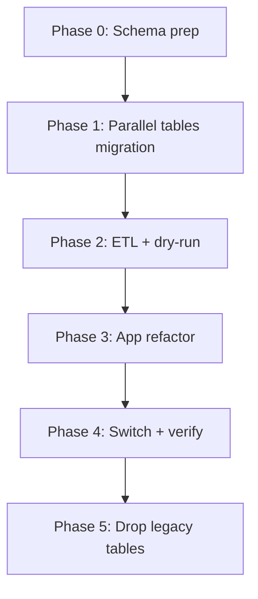

# คู่มือ Schema Migration & Refactoring — Teen Mind

แผน execute ที่ตกลงแล้วจากการ grill (`/grill-with-docs`)  
อ้างอิง: `CONTEXT.md`, `docs/adr/0001-schema-cutover-parallel-tables.md`, `docs/adr/0002-screening-result-orange-red.md`

---

## 1. เป้าหมายและนิยาม “เสร็จ”

**เป้าหมายรอบนี้**
- Apply schema v2 ลง DB (คู่ขนานกับของเก่า)
- ETL ข้อมูล legacy → โมเดลใหม่
- Refactor โค้ดทั้ง repo ให้ใช้ชื่อ/รูปใหม่
- Drop ตารางเก่าเมื่อสลับแอปแล้ว

**เสร็จเมื่อ**
- [ ] `npx tsc --noEmit` ผ่าน
- [ ] `npm run test` ผ่าน
- [ ] `npm run build` ผ่าน
- [ ] Dry-run ETL ผ่านเกณฑ์ใน §4
- [ ] ตรวจบน **dev** แล้ว **staging** (production = ขั้นถัดไป นอกเอกสาร execute หลักนี้ มี checklist ใน §7)

**นอกขอบเขทรอบ deploy prod:** การตัดเข้า production จริง — ใช้ §7 เป็นเกตเท่านั้น

---

## 2. ภาษาโดเมน (ย่อ)

| ใช้คำนี้ | ความหมาย | เลิกใช้ |
| :--- | :--- | :--- |
| **Case** | เคสคัดกรอง/ติดตามหนึ่งราย | Questions_Master |
| **TreatmentNote** | บันทึกรอบ follow-up หนึ่งรอบ (SOAP + นัด + telemed) | คอลัมน์แบน consult2/subjective2/… |
| **Volunteer** | อาสา/ผู้ส่งต่อ | Referent |
| **ProfileAdmin** | โปรไฟล์เจ้าหน้าที่ | Profile_Admin |
| **CaseStatus** | workflow: PENDING / IN_PROGRESS / TRANSFER_PENDING / CLOSED | สถานะ 0–3 |
| **Follow-up progress** | ความครบของรอบ (derive จาก TreatmentNote + HN) ค่า UI เดิม 0–3 | เก็บใน `Case.status` |
| **ScreeningResult** | ผลคัดกรองบน Case (รวม `POSITIVE_SEVERE` = Red) | เก็บเป็นสตริงสี Green/… |

---

## 3. ลำดับงาน (Phases)



### Phase 0 — Schema prep
- [ ] เพิ่ม `POSITIVE_SEVERE` ใน `enum ScreeningResult` (`prisma/schema.prisma` + `schema.prisma.example`)
- [ ] ยืนยัน mapping สี → enum:
  - Green → `NEGATIVE`
  - Green-Low → `POSITIVE_LOW`
  - Yellow → `POSITIVE_MODERATE`
  - Orange → `POSITIVE_HIGH`
  - Red → `POSITIVE_SEVERE`
  - ว่าง/ไม่ครบ → `INCOMPLETE`
- [ ] `npx prisma generate`

### Phase 1 — Parallel tables (ADR 0001)
- [x] Dev (`teenmind-dev-v3`): park legacy → `legacy_*` (`scripts/park-legacy-tables-for-v2.js`)
- [x] CREATE v2 tables beside legacy (`scripts/apply-v2-schema-sql.js` / `scripts/sql/create-v2-schema.sql`)
- [x] Migration recorded: `20260907120000_parallel_v2_beside_legacy` (resolve --applied)
- [ ] Apply equivalent process on **staging**
- [x] Legacy data still readable under `legacy_*` (e.g. `legacy_questions_master`)

### Phase 2 — ETL (`scripts/migrate-legacy-data.ts`)
- [x] ETL จริง + `--dry-run` / `--apply` (แหล่งข้อมูล `legacy_*` บน dev)
- [x] Dry-run + apply บน **teenmind-dev-v3** ผ่านเกณฑ์นับแถว / ScreeningResult / spot-check
- [ ] รันบน staging ตาม process เดียวกัน


**Mapping**
| Legacy | ใหม่ |
| :--- | :--- |
| `profile` | `Profile` (`firstname`→`firstName`, `birthday`→`birthDate`, `tel`→`phone`, sex 1/2→`MALE`/`FEMALE`, อื่น/`null`→`UNSPECIFIED`) |
| `address` | `Address` (`province`→`provinceId`, …) |
| `emergencycontact` | `EmergencyContact` (`tel`→`phone`) |
| `profile_admin` | `ProfileAdmin` (`alert`→`receiveAlert`, …) |
| `referent` | `Volunteer` |
| `questions_master` | `Case` + `TreatmentNote` (แยก round 1–3 จากคอลัมน์แบน) |
| `questions_*` | `Question*` ผูก `caseId`, **`round = 1`** ทุกแถว legacy |

**กฎ Case**
- [ ] `Case.id` = `questions_master.id` (คง id เดิม)
- [ ] `Case.result` ตามแมป ScreeningResult ด้านบน
- [ ] `Case.status`:
  - ไม่มี TreatmentNote / ยังไม่ครบรอบ 1 consult+telemed → `PENDING`
  - รอบ 1 consult+telemed ครบ → `IN_PROGRESS`
  - follow-up จบแล้ว (**กี่รอบก็ได้**) → `CLOSED`
  - `TRANSFER_PENDING` **ไม่แมป** — ปรับมือทีหลัง
- [ ] Follow-up 0–3 **ไม่เขียนลง** `Case.status` — เหลือให้แอป derive

**เกณฑ์ dry-run ผ่าน**
- [ ] นับแถวต้นทาง ≈ ปลายทาง (Profile, Case, TreatmentNote ต่อรอบที่มีข้อมูล, questionnaire)
- [ ] ไม่มี FK หลุด
- [ ] สุ่มตรวจ N เคส (ฟิลด์หลัก + รอบ SOAP)
- [ ] สถิติผลคัดกรองหลังแมปสีตรงกับของเก่า

### Phase 3 — App refactor (ทั้ง repo ไม่จำกัดไฟล์ใน guide เดิม)

- [x] Core auth/helpers → ProfileAdmin / Volunteer / receiveAlert
- [x] LIFF register + types ใช้ฟิลด์ใหม่
- [x] Case create/read + questionnaires บนโมเดล v2
- [x] TreatmentNote flatten (`lib/case-flat.ts`) สำหรับ follow-up helpers
- [x] Admin UI / dashboard / analytics ตัดชื่อเก่า
- [x] `npx tsc --noEmit` + `npm test` + `npm run build` ผ่านบน dev

#### 3.1 Core auth & helpers
- [x] `lib/get-session.ts` — `profileAdmin`, `volunteer`
- [x] API ที่เคยใช้ `prisma.profile_Admin` / `prisma.referent`
- [x] ฟิลด์ Profile: `firstName`, `lastName`, `birthDate`, `phone`, `Sex`
- [x] `receiveAlert` แทน `alert`

#### 3.2 LIFF register
- [x] `app/liff/register/**` (Volunteer)
- [x] `types/initData.ts` และชนิดที่เกี่ยวข้อง

#### 3.3 Case / assessment / follow-up
- [x] `prisma.case` (+ `treatmentNotes`)
- [x] follow-up progress derive / flatten จาก TreatmentNote
- [x] Questionnaire models: `Question9Q`, `QuestionPhqa`, …
- [x] `app/api/question/**`, dashboard routes

#### 3.4 Admin UI & reports
- [x] ตาราง/ฟิลเตอร์ใช้ `ScreeningResult` (+ แมปสีใน UI helpers)
- [x] report / productivity / map / export / members
- [x] ลบชนิด Prisma ชื่อเก่าจาก imports

### Phase 4 — Switch & verify
- [x] ชี้แอปไปโมเดลใหม่บน **dev** (`tsc` / `test` / `build` ผ่าน)
- [ ] Smoke บน staging: login LIFF, register, Case, TreatmentNote, admin list/filter, alert Red
- [ ] Production gate — §7

### Phase 5 — Drop legacy
- [ ] Migration ลบตาราง/คอลัมน์เก่า หลังยืนยัน staging
- [ ] ลบโค้ด/คอมเมนต์ที่อ้างชื่อเก่า

---

## 4. Field & model cheat sheet

| พื้นที่ | เดิม | ใหม่ |
| :--- | :--- | :--- |
| Profile | `firstname` `lastname` `birthday` `tel` | `firstName` `lastName` `birthDate` `phone` |
| Profile.sex | `Int` 1/2 | `Sex` enum |
| Address | `province` `district` `subdistrict` | `provinceId` `districtId` `subdistrictId` |
| EmergencyContact | `tel` | `phone` |
| Admin model | `Profile_Admin` / `profile_Admin` | `ProfileAdmin` / `profileAdmin` |
| Admin alert | `alert` | `receiveAlert` |
| Volunteer | `Referent` / `referent` | `Volunteer` / `volunteer` |
| Types | `Volunteer_Type` `Employee_Type` | `VolunteerType` `EmployeeType` |
| Case | `Questions_Master` / `questions_Master` | `Case` / `case` |
| Notes | คอลัมน์แบนบน master | `TreatmentNote` (`round` 1..n) |
| 9Q / PHQ-A | `Questions_9Q` `Questions_PHQA` | `Question9Q` `QuestionPhqa` |

---

## 5. ไฟล์ที่รู้ว่ากระทบหนัก (ไม่ครบทุกรายการ — ใช้ grep เป็นแหล่งความจริง)

**เริ่มจาก (เดิมใน guide)**
- `lib/get-session.ts`
- `lib/report-age-range.ts`
- `lib/assessment-recalculate-preview.ts`
- `app/liff/register/**`
- `types/initData.ts`

**ต้องไล่เพิ่ม (พบจากการสำรวจ)**
- `lib/question-followup-rounds.ts` และ callers
- `app/api/question/**`
- `prisma.questions_Master` (~26 ไฟล์), `birthday` / `firstname` (กระจายกว้าง)
- Admin dashboard / map / export / members / psychologist-productivity

ก่อนปิด Phase 3 รันอย่างน้อย:
```bash
rg "prisma\.(questions_Master|profile_Admin|referent)" -g "*.ts" -g "*.tsx"
rg "\b(firstname|birthday|schedule_telemed2|subjective2)\b" -g "*.ts" -g "*.tsx"
```

---

## 6. คำสั่งตรวจสอบ

```bash
npx prisma generate
npx tsc --noEmit
npm run test
npm run build
# หลังมี ETL จริง:
node scripts/migrate-legacy-data.js --dry-run
```

---

## 7. Staging → Production (เกต ไม่ใช่ execute หลักของรอบนี้)

- [ ] Dry-run + apply ETL บน staging สำเร็จตาม §4
- [ ] Smoke §4 ผ่านบน staging
- [ ] Backup DB ก่อนตัด prod
- [ ] หน้าต่าง downtime / สื่อสารทีม
- [ ] Apply parallel migration → ETL → deploy แอป → เฝ้าระวัง → drop legacy เมื่อมั่นใจ
- [ ] แผน rollback: ชี้แอปกลับตารางเก่าได้จนกว่าจะ drop

---

## 8. สิ่งที่ทำไปแล้วใน repo (docs)

- [x] `CONTEXT.md` — glossary
- [x] `docs/adr/0001-schema-cutover-parallel-tables.md`
- [x] `docs/adr/0002-screening-result-orange-red.md`
- [x] `docs/agents/*` — issue tracker / triage / domain layout
